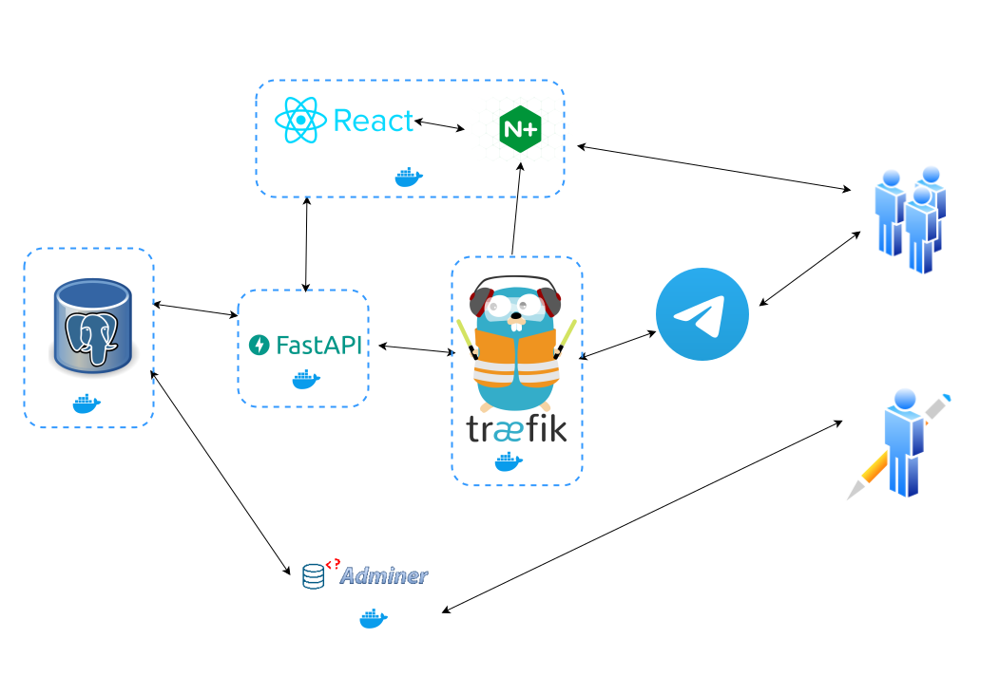

## Technology Stack and Features

### Backend

- ⚡ [**FastAPI**](https://fastapi.tiangolo.com) for the Python backend API.
    - 🧰 [SQLAlchemy](https://www.sqlalchemy.org) for the Python SQL database interactions (ORM).
    - 🔍 [Pydantic](https://docs.pydantic.dev), used by FastAPI, for the data validation and settings management.
    - 💾 [PostgreSQL](https://www.postgresql.org) as the SQL database.
    - 📨 [**Apache Kafka**](https://kafka.apache.org/) event-driven message queue via [aiokafka](https://github.com/aio-libs/aiokafka) for asynchronous card reviews, progress tracking, and decoupled worker processing.
    - ✅ Tests with [Pytest](https://pytest.org).
    - 🔑 JWT (JSON Web Token) authentication.
    - 📨 [Aiogram](https://aiogram.dev) for Telegram bot development.

### Frontend

- 🚀 [React](https://react.dev) for the frontend.
    - 💃 Using TypeScript, hooks, Vite, and other parts of a modern frontend stack.
    - 🎨 [Chakra UI](https://chakra-ui.com) for the frontend components.
    - 🤖 An automatically generated frontend client.
    - 🧪 [Playwright](https://playwright.dev) for End-to-End testing.

### Infrastructure

- 🐋 [Docker Compose](https://www.docker.com) for development and production.
- 📬 [Apache Kafka](https://kafka.apache.org/) (KRaft mode) & asynchronous Kafka worker service container.
- 📞 [Traefik](https://traefik.io) as a reverse proxy / load balancer.
- 🚢 Deployment instructions using Docker Compose, including how to set up a frontend Traefik proxy to handle automatic HTTPS certificates.
- 📱 [Telegram API](https://core.telegram.org/bots/api) integration

Services architecture visualization:

## How To Use It or Run Locally

### Prerequisites

Before running the application, ensure you have the following installed:
- Python 3.8 or higher
- Node.js and npm
- Docker and Docker Compose

### Configure

You can then update configs in the `.env` files to customize your configurations.

## Backend Development

Backend docs: [backend/README.md](./backend/README.md).

## Frontend Development

Frontend docs: [frontend/README.md](./frontend/README.md).

## Deployment

Deployment docs: [deployment.md](./deployment.md).

## Development

General development docs: [development.md](./development.md).

This includes using Docker Compose, custom local domains, `.env` configurations, etc.
